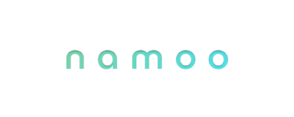

<h3>Hello, I'm namoo!</h3>

- 🐤 I'm interested in building interactive experiences.
- 💻 I worked as a frontend engineer at Mathpresso(QANDA).
- 🏫 I'm majoring in Computer Science at Yonsei University.

&nbsp;&nbsp;

<h3>What I've done</h3>

- 📱 (2016-2020) I developed an Android app locker that reached 35K cumulative downloads. ([namoo protector](https://play.google.com/store/apps/details?id=nm.security.namooprotector))
- 🏆 (2021) I won a Gold Award at the ICPC Sinchon Camp Algorithm Contest.
- 🏆 (2024) My team was selected as a Top 100 finalist in the Solution Challenge hosted by GDSC(Google Developer Student Clubs) ([fluentify](https://github.com/gdg-yonsei/fluentify-flutter))
- 🏢 (2022-2026) I worked as a frontend engineer at [Mathpresso(QANDA)](https://mathpresso.com/), an EdTech startup.

&nbsp;&nbsp;

<h3>Feel free to contact me!</h3>

 

